  

  
  
  

I'm an AI/ML engineer at **[66degrees](https://66degrees.com)** in Bengaluru, working
forward-deployed with enterprise clients on Google Cloud. I build agents with **Google ADK,
Vertex AI and Gemini**, take them from the first demo to production rollout, and care a lot about
the unglamorous part: knowing whether an agent actually did the right thing.

### At work

- **80% faster IT ticket closure.** A multi-agent system on Google ADK, wired into ServiceNow and
  SAP SuccessFactors, so employees raise IT tickets and ask HR benefits questions in one conversation.
- **About $600K saved on leases.** A Gemini Enterprise agent that tracks 800+ manufacturing leases,
  flags upcoming expirations and uses purchase-order data to inform pricing.
- **45% lower handle time for 1,000+ support agents.** A contact-centre intelligence dashboard
  embedded in Genesys with real-time predictive insights.

### Things I've built

A thread runs through these: **agents that have to prove their work**, through traces, sandboxed
proof, human overrides or blind judges.

| Project | What it does | Result |
|---|---|---|
| **[ClinTrace](https://github.com/Reuben-Alex/ClinTrace)** | Emergency-department triage agent. Free-text nursing intake in, ESI level, red-flag alerts and a routing order out. Every step is traced in Arize Phoenix, and nurse overrides recalibrate similar future cases without retraining. | 🏆 **3rd of 245** final-round submissions, Arize track, Google Cloud Rapid Agent Hackathon |
| **[Re-entry](https://github.com/Reuben-Alex/re-entry)** | Finds a smart-contract bug, *proves* it by writing and running an exploit in a local sandbox, patches it, then replays the exploit to verify the fix. | Agent-written exploits on 5 of 13 targets, 13 of 13 safe controls correctly clean. Misses published. |
| **[Tough Crowd](https://github.com/Reuben-Alex/tough-crowd)** | Claude Code plugin: the agent directs a product film shot by shot, then three blind judges who never saw the code decide what gets reshot. | Zero runtime dependencies; benchmark in progress and reported honestly |
| **[Revenant](https://github.com/Reuben-Alex/Revenant)** | Early-warning map for "zombie" wildfires that smoulder under the snow and flare up on last year's burn scar. | Built on NASA FIRMS, GIBS and NBAC data, with a chance baseline it has to beat |

### Toolbox

  
  
  
  
  
  
  
  
  
  
  
  

**Certifications:** Google Cloud Professional Machine Learning Engineer · Google Cloud Generative AI
Leader · Gemini Enterprise Agent Development and Deployment partner specialist

### Right now

Building open-source tooling for the Google ADK ecosystem. Happy to talk about agents, evals and
getting LLM systems through enterprise rollouts. The quickest way to reach me is
[LinkedIn](https://www.linkedin.com/in/reuben-alex-3968b62a2/).
