<picture>
  <source media="(prefers-color-scheme: dark)" srcset="assets/banner-dark.svg">
  
</picture>

  
  
  

I'm an AI/ML engineer at **[66degrees](https://66degrees.com)** (a Google Cloud AI Partner of the
Year) in Bengaluru. I work forward-deployed with enterprise clients, taking agents built on
**Google ADK, Vertex AI and Gemini** from discovery to production rollout. Across six client
engagements, the part I care about most is the one demos skip: **proving the agent did the right
thing**.

<picture>
  <source media="(prefers-color-scheme: dark)" srcset="assets/stats-dark.svg">
  
</picture>

## 🧪 Things I've built

Each one makes an agent **show its work**: through traces, a working exploit, a nurse's override,
or judges who never saw the code.

<table>
<tr>
<td width="50%" valign="top">

### [ClinTrace](https://github.com/Reuben-Alex/ClinTrace)
🏆 **3rd of 245** · Arize track, Google Cloud Rapid Agent Hackathon

An emergency-department triage agent, built solo. Free-text nursing intake goes in. An ESI level,
red-flag alerts and a routing order come out. Every step is traced in Arize Phoenix, and nurse
overrides recalibrate similar future cases **without retraining**. Validated on real CDC ED data.

`Google ADK` `Vertex AI Agent Engine` `Gemini` `Arize Phoenix` `BigQuery`

[Code](https://github.com/Reuben-Alex/ClinTrace) · [Demo video](https://www.youtube.com/watch?v=hKs4fqzKKHw)
</td>
<td width="50%" valign="top">

### [Re-entry](https://github.com/Reuben-Alex/re-entry)
🔐 **Prove the bug. Prove the fix.**

An agent that writes a fresh exploit for a smart contract, runs it in a local sandbox, and feeds
the real revert reason into its next attempt. It reports a bug only once the exploit has worked,
then patches the contract and replays the exploit to confirm the fix. Agent-written exploits
succeeded on **5 of 13** targets, all **13 of 13** safe controls came back clean, and the misses
are published.

`NVIDIA Nemotron` `Nebius` `Anvil` `Solidity` `Python`

[Code](https://github.com/Reuben-Alex/re-entry) · [Demo video](https://www.youtube.com/watch?v=LTIwdPee_do)
</td>
</tr>
<tr>
<td width="50%" valign="top">

### [Tough Crowd](https://github.com/Reuben-Alex/tough-crowd)
🎬 **Claude Code plugin**

The agent directs a product film shot by shot. Then three blind judges, who have never seen the
code, the conversation or each other, decide what gets reshot. Zero runtime dependencies. The
benchmark is in progress and reported honestly, including when it doesn't win.

`Claude Code` `HyperFrames` `Node 22` `LLM-as-judge`

[Code](https://github.com/Reuben-Alex/tough-crowd)
</td>
<td width="50%" valign="top">

### [Revenant](https://github.com/Reuben-Alex/Revenant)
🔥 **What burned last summer is not always dead.**

An early-warning map for "zombie" wildfires: fires that smoulder under the snow and flare up on
last year's burn scar. It tests each spring against a chance baseline it has to beat, and says so
when it doesn't.

`NASA FIRMS` `VIIRS` `React` `Python` `Kiro`

[Code](https://github.com/Reuben-Alex/Revenant)
</td>
</tr>
</table>

## 🔭 Currently building

**`adk-upgrade-check`** is an open-source upgrade checker for Google ADK. Run it before you bump
`google-adk` and it flags the code, config and session-database changes the new release will
break, then auto-fixes the safe ones. ADK has shipped breaking changes in five minor releases since
2.0, and nothing checks user code for them yet. *Repo coming soon.*

## 🧰 Toolbox

  
  
  
  
  
  
  
  
  
  
  
  
  
  
  
  

## 🎖️ Certifications

Click a badge to verify it on Credly.

  
  
  
  
  
  
  

Also: Certified Partner Specialist in Gemini Enterprise Agent Development and in Gemini Enterprise
Deployment (Google Cloud Partner).

<b>📈 More from the field</b>

 

| When | Where | What |
|---|---|---|
| 2025 to now | **66degrees**, Associate AI/ML Engineer | Multi-agent IT and HR assistant (ServiceNow + SAP SuccessFactors) that cut **80%** of manual ticket-closure time. Lease-intelligence agent on Gemini Enterprise covering **800+** leases and saving about **$600K**. Contact-centre intelligence in Genesys, with handle time down **45%** across **1,000+** agents. Dialogflow CX voice bot for a healthcare client covering **30+** call intents. |
| 2024 to 2025 | **66degrees**, AI/ML intern | Computer-vision pipeline on Meta's **SAM2** that segments antennas, RRUs, cabling and mounts from tower imagery, improving tower space utilisation by **30%**. |
| 2023 to 2024 | **Mu Sigma**, internship trainee | Business and IT analysis for analytics engagements. |

---

  Building agents, evals and the unglamorous tooling around them.
  The quickest way to reach me is <a href="https://www.linkedin.com/in/reuben-alex-3968b62a2/">LinkedIn</a>.

