  <a href="https://reubenalex.vercel.app"><b>Website</b></a> &nbsp;·&nbsp;
  <a href="https://www.linkedin.com/in/reuben-alex-3968b62a2/"><b>LinkedIn</b></a> &nbsp;·&nbsp;
  <a href="https://devpost.com/reubenalexa"><b>Devpost</b></a> &nbsp;·&nbsp;
  <a href="mailto:reubenalexa@gmail.com"><b>Email</b></a>

I work forward-deployed with enterprise clients at **66degrees**, a Google Cloud AI Partner of the
Year, taking agents built on **Google ADK, Vertex AI and Gemini** from discovery into production.
On the side I build agents that have to **show their work**: through traces, a working exploit,
a nurse's override, or judges who never saw the code.

## Selected work

<table>
<tr>
<td width="50%" valign="top">

**[ClinTrace](https://github.com/Reuben-Alex/ClinTrace)**: an emergency-department triage agent,
built solo. It scores severity, flags red flags and routes the patient, with every step traced in
Arize Phoenix. Nurse overrides recalibrate similar future cases without retraining.

🏆 **3rd of 245**, Arize track, Google Cloud Rapid Agent Hackathon 
Google ADK · Vertex AI Agent Engine · Gemini · Arize Phoenix · BigQuery 
[Code](https://github.com/Reuben-Alex/ClinTrace) · [Video](https://www.youtube.com/watch?v=hKs4fqzKKHw) · [Devpost](https://devpost.com/software/clintrace)
</td>
<td width="50%" valign="top">

**[Re-entry](https://github.com/Reuben-Alex/re-entry)**: an agent that proves smart-contract bugs
by writing an exploit and running it in a sandbox, then patches the contract and replays the
exploit to prove the fix holds.

**5 of 13** targets exploited by the agent, **13 of 13** safe controls clean 
Nebius x NVIDIA Global AI Hackathon · Nemotron · Anvil · Solidity 
[Code](https://github.com/Reuben-Alex/re-entry) · [Live demo](https://re-entry-258166629293.us-central1.run.app/) · [Video](https://www.youtube.com/watch?v=LTIwdPee_do) · [Devpost](https://devpost.com/software/re-entry-h7ba93)
</td>
</tr>
<tr>
<td width="50%" valign="top">

**[Revenant](https://github.com/Reuben-Alex/Revenant)**: an early-warning map for zombie wildfires,
which smoulder under the snow and flare up on last year's burn scar. Each spring is tested against
a chance baseline, and the app says so when it doesn't beat it.

Kiroween 2026 · NASA FIRMS · VIIRS · React · Python 
[Code](https://github.com/Reuben-Alex/Revenant)
</td>
<td width="50%" valign="top">

**[Tough Crowd](https://github.com/Reuben-Alex/tough-crowd)**: a Claude Code plugin. The agent
directs a product film shot by shot, then three blind judges decide what gets reshot. The benchmark
is reported honestly, including when it doesn't win.

Claude Code · HyperFrames · Node 22 · zero dependencies 
[Code](https://github.com/Reuben-Alex/tough-crowd)
</td>
</tr>
</table>

**Also:** [KeyRing](https://devpost.com/software/keyring-x3h8r9) mints 60-second, scoped
credentials for each agent task, and blocks policy changes that widen access until they're verified
safe. Built on GitLab Duo flows. ([video](https://www.youtube.com/watch?v=4wwa72Qe9cY))

**Now building:** `adk-upgrade-check`, an open-source upgrade checker for Google ADK. It flags the
code, config and session-database changes a new `google-adk` release will break, before you bump.

## At work

| | |
|---|---|
| **80%** faster IT ticket closure | Multi-agent assistant on Google ADK, integrated with ServiceNow and SAP SuccessFactors |
| **~$600K** saved | Gemini Enterprise agent tracking 800+ manufacturing leases and informing pricing |
| **−45%** handle time, 1,000+ agents | Contact-centre intelligence embedded in Genesys |
| **30+** call intents | Dialogflow CX voice bot for a healthcare client |
| **+30%** tower space utilisation | SAM2 computer-vision pipeline (internship) |

Python · Google ADK · Vertex AI · Gemini · Gemini Enterprise · Dialogflow CX · BigQuery · Arize Phoenix · OpenTelemetry · LangChain · PyTorch · Docker · Terraform

## Certifications

Click a badge to verify it on Credly. Also a Google Cloud Certified Partner Specialist in Gemini Enterprise Agent Development and Deployment.
